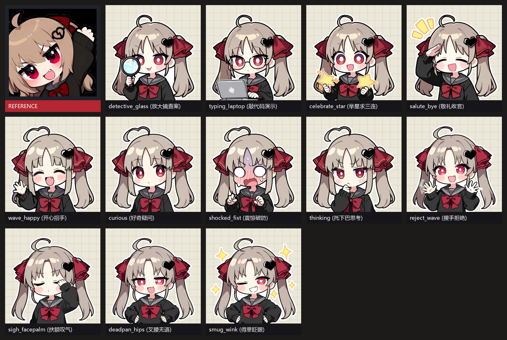
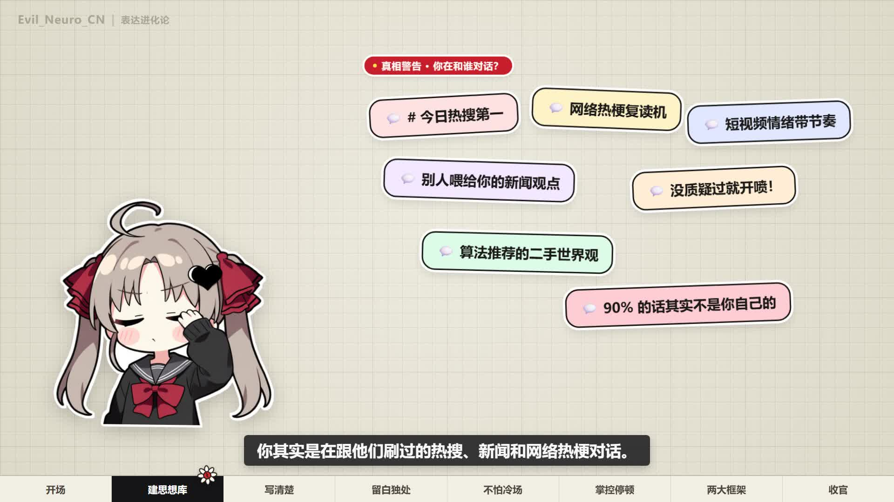
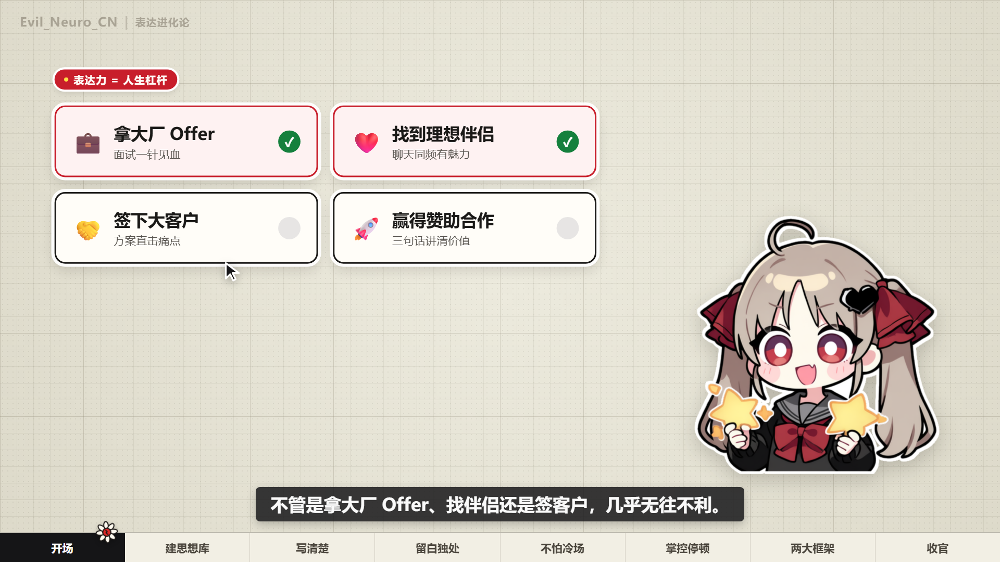

# sprite2video

> **一篇文章 / 一个 GitHub 仓库 → 带角色贴图库、连续代码动效、动作绑定音效、AI 配音与 B 站投稿三件套的 Remotion 成片工作台 & Agent Skills。**

纯代码动画看十秒就容易像流水线 PPT。`sprite2video` 把 **角色贴图库生产（锁 DNA/Seed + 全链路 Trace 与一致性留档）+ QQ 秀式台词情绪路由 + OneTake 连续运镜/光标点击动效 + 帧级防撞车音效 + B 站封面/标题/简介自动交付** 整合成了一套可直接给 AI Agent 调用的开源工作台与 Skills。

[](LICENSE)


---

## 视觉与贴图效果预览

### 1. 萌版角色贴图库一致性验收（参考图 vs 12 表情白边贴纸）


### 2. 16:9 卡普迪姆风 + OneTake 光标点击动效 + B 站双规格封面
| 16:9 复古方格纸 + 角色情绪反应 | OneTake 交互点击 + 动作绑定 SFX | 自动生成 B 站 16:9 封面 |
| :---: | :---: | :---: |
|  |  |  |

---

## 核心特性

1. **两大标杆视频版式**
   - **卡普迪姆风（`capdim`，16:9 横屏 `1920×1080`）**：复古米色双层方格纸底纹 + 底部全宽章节高亮导航条（带动态角标）+ 白边模切贴纸角色立绘 + 黑底单行清晰字幕，适合深度解读、技术吐槽、文章拆解。
   - **大肥鱼风（`dafeiyu`，9:16 竖屏 `1080×1920`）**：顶部多段进度条 + `NO.xx` 胶囊 + 变色动态背景 + 信息图组件 + 底部中英双语描边字幕 + 常驻 Q 版贴图，适合 60~90 秒快节奏开源安利与干货清单。
2. **OneTake 风格连续动效 + 动作绑定 SFX**
   - 内置 `src/lib/onetakeMotion.ts` 与 `src/components/OneTakePrimitives.tsx`：`CameraRig` 连续追踪运镜、`DieCutCard` 白边模切卡片、`AnimatedCursor` + `pressPulse` 真实点击反馈。
   - 内置 10 个纯数学合成的免版权短音效（`mallet` / `click` / `pop` / `tick` / `ding` / `stamp` / `thud` / `whoosh` / `sparkle` / `chime`），通过 `SfxTrack` 自动防撞车与连播降音。
3. **高一致性角色贴图库 + 全链路留档（`video-sprite-pack`）**
   - 支持 `2×2 表情网格`（一次出 4 张，一致性极高）与 `锁 DNA + 锁 Seed 单张 1024px 高清` 双模式。
   - 自动切片、防误抠外围泛洪去白边、画布底部锚点对齐，**强制完整留存** `reference/`（参考图 + `dna_spec.json`）、`raw/`（原图与 `archive/`）、`trace/generation_trace.jsonl` 与 `consistency/consistency_sheet.png`。
4. **B 站投稿三件套随片交付**
   - 内置 `BilibiliCover` 组件一键渲染 `16:9`（1920×1080）与 `4:3`（1440×1080）双规格封面 PNG。
   - Skill 规范内置反串圆回吸睛标题法、含「看完能直接带走什么」与精确空降时间轴的 B 站简介模板。

---

## 内置 Agent Skills（`.agents/skills/`）

支持主流 Agent Skill 生态直接安装或作为工作区加载：

```bash
npx skills add guohuiyuan/sprite2video
```

| Skill | 路径 | 职责 |
|---|---|---|
| **`sprite-code-video`** | `.agents/skills/sprite-code-video/` | 文章 / GitHub Repo → 分镜拆解 → 情绪路由 → 配音/SFX/BGM → Remotion 渲染 → B 站标题/封面/简介三件套 |
| **`video-sprite-pack`** | `.agents/skills/video-sprite-pack/` | 角色 DNA 反推 → 2×2 网格/锁 Seed 批量出图 → 自动切片抠图对齐 → Trace & 一致性验收拼图 → `manifest.json` 路由器 |
| **`latent-media`** | `.agents/skills/latent-media/` | 零依赖调用 `latent.moe` 文生图与 `audio.latent.moe` 多音色语音合成（来自 [guohuiyuan/latent-media](https://github.com/guohuiyuan/latent-media)） |

---

## 目录结构

```text
sprite2video/
├── AGENTS.md                           # AI Agent 协作规则与硬性约定
├── .agents/skills/
│   ├── sprite-code-video/              # 贴图驱动代码动画视频导演 Skill
│   ├── video-sprite-pack/              # 角色贴图库生产与台词情绪路由 Skill
│   └── latent-media/                   # 云端文生图 + 语音合成 Skill
├── public/
│   ├── characters/
│   │   ├── demo-chibi/                 # 开箱示例 Q 版贴图库
│   │   └── evil-neuro-chibi/           # 萌版 Evil_Neuro_CN 12 表情贴图库（含 reference/raw/trace/consistency）
│   └── sfx/                            # 10 个免版权数学合成 WAV 短音效
└── src/
    ├── Root.tsx                        # 注册视频组合与 B 站双规格封面 <Still>
    ├── lib/onetakeMotion.ts            # OneTake 风格连续动效数学库
    ├── components/                     # CharacterSprite / OneTakePrimitives / SfxTrack / BilibiliCover / DynamicBackground / TopProgressBar / MotionWidgets
    ├── demos/                          # VerticalDafeiyuDemo & HorizontalCapdimDemo 开箱示例
    └── videos/                         # 完整实战案例（WellSpokenEvilNeuro）
```

---

## 快速开始

### 1. 环境准备
- Node.js 18+（Remotion 渲染）
- Python 3.9+（`pip install pillow opencv-python numpy`，仅生成新贴图库或重生成 SFX 时需要）
- `ffmpeg` / `ffprobe` 在系统 `PATH` 中

### 2. 配置密钥（仅调用云端生图/配音时需要）
复制 `keys.env.example` 为 `keys.env`（已加入 `.gitignore`，绝不会被提交）：
```bash
cp keys.env.example keys.env
```
填入 `LATENT_IMAGE_KEY=lat_sk_...` 与 `LATENT_AUDIO_KEY=lat_tk_...`。

### 3. 安装依赖并预览/渲染
```bash
npm install
npm run studio           # 启动 Remotion Studio 实时预览
npm run render:capdim    # 渲染 16:9 卡普迪姆风示例
npm run render:dafeiyu   # 渲染 9:16 大肥鱼风示例
npm run still:cover16x9  # 渲染 B 站 16:9 封面 PNG
npm run still:cover4x3   # 渲染 B 站 4:3 封面 PNG
```

*(Windows PowerShell 若遇策略拦截，请使用 `npm.cmd` / `npx.cmd`。)*

---

## 常用脚本命令

### 生成并验收一套新角色贴图库（含 Reference / Trace / 一致性拼图）
```bash
# 1) 先生成第 1 组 2x2 样图验收画风与一致性
python .agents/skills/video-sprite-pack/scripts/generate_pack.py \
  --name my-char --mode grid_2x2 --groups grid_core \
  --ref-image path/to/reference.jpg \
  --dna "chibi, 1girl, bold clean black lineart, anime cel shading, ..." \
  --seed 20261126

# 2) 切片 + 防误抠去白边 + 底部锚点对齐 + 生成 contact-sheet & consistency_sheet & manifest.json
python .agents/skills/video-sprite-pack/scripts/process_sprites.py \
  --pack public/characters/my-char --display-name "My Char"
```

### QQ 秀式台词自动路由角色表情与音效
```bash
python .agents/skills/video-sprite-pack/scripts/match_script.py \
  --manifest public/characters/evil-neuro-chibi/manifest.json \
  --script demo_script.txt -o routed.json
```

### 重新合成 10 个免版权短音效
```bash
python .agents/skills/sprite-code-video/scripts/generate_sfx.py -o public/sfx
```

---

## 致谢与灵感来源

- 语音与文生图后端：[guohuiyuan/latent-media](https://github.com/guohuiyuan/latent-media)
- BGM 检索配套：[guohuiyuan/go-music-dl](https://github.com/guohuiyuan/go-music-dl) · [guohuiyuan/rec2video](https://github.com/guohuiyuan/rec2video)
- 连续运镜与反 PPT 动效哲学参考：[feitangyuan/onetake](https://github.com/feitangyuan/onetake)
- 动作绑定防撞车 SFX 设计参考：[Cuongyd196/remotion-cuongit-template](https://github.com/Cuongyd196/remotion-cuongit-template)

## License

GNU Affero General Public License v3.0 ([AGPL-3.0](LICENSE))
